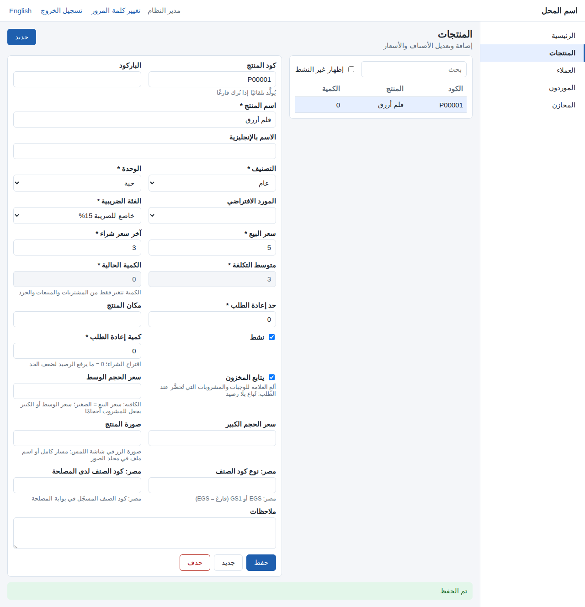
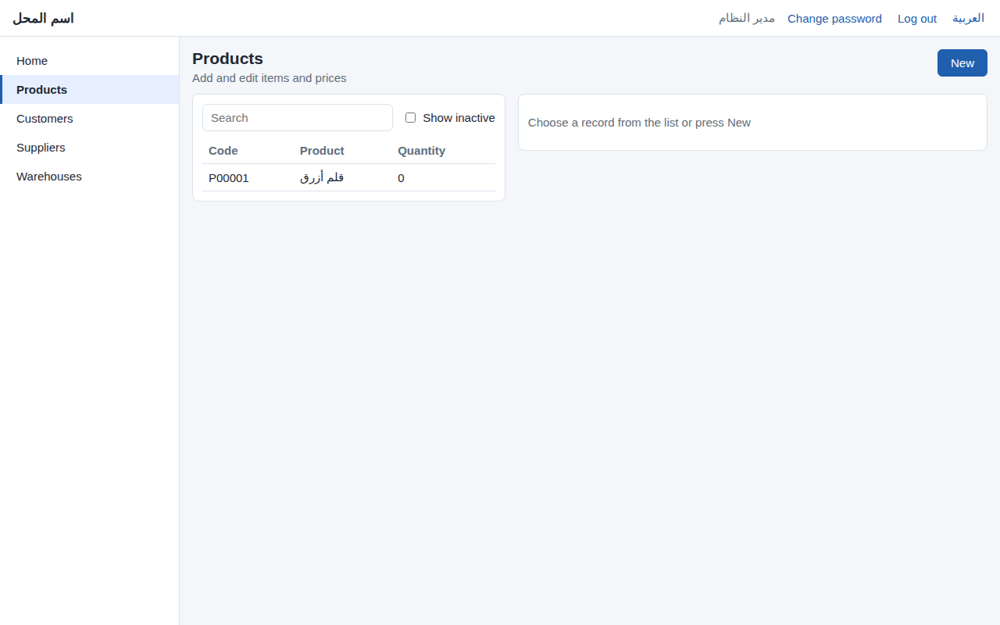
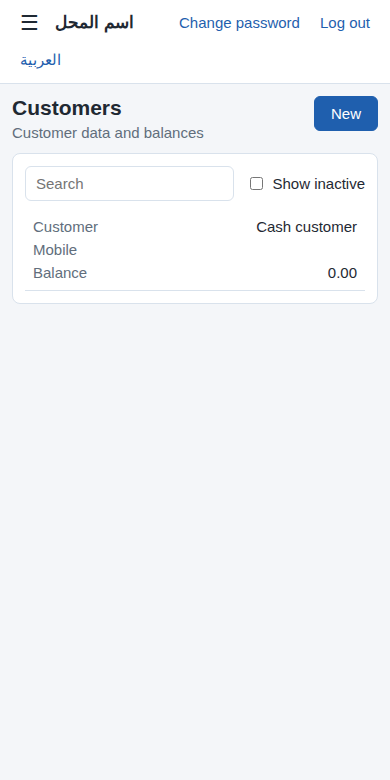

# أساس نسخة الويب (المرحلة 6أ)

**الفكرة:** أول مرحلة من الخطة 6 (`docs/51`): نظام واحد بلغة C#، واجهته Blazor على .NET 10. هذه المرحلة تبني **الأساس**. المراحل التالية تضيف إليه المبيعات والمشتريات والمحاسبة.

- **قبلها:** البرنامج يعمل في Access فقط، على جهاز Windows.
- **الآن:** موقع ويب يعمل في أي متصفح، على الكمبيوتر والتابلت والجوال:
  1. **الدخول** بنفس المستخدمين وكلمات المرور الموجودة في Access؛
  2. **الصلاحيات** نفسها: الأدوار، وصلاحيات الشاشات لكل مستخدم؛
  3. **العربية من اليمين لليسار والإنجليزية من اليسار لليمين**، بضغطة؛
  4. **شاشات البيانات الأساسية:** المنتجات، والعملاء، والموردون، والمخازن؛
  5. **منطق القيود اليومية بلغة C#**، بنفس قواعد Access، مع اختباراته.

**الموقع والبرنامج يعملان معًا على البيانات نفسها:** على قاعدة SQL Server (الخطة 5). ما يُضاف في الموقع يظهر في Access فورًا، والعكس. سجل التدقيق واحد للاثنين.

**لا تغيير في Access في هذه المرحلة:** لا وحدة تُستورد ولا أمر بناء.



## 1) ما يعمل الآن

### الدخول وكلمة المرور
- **الدخول** باسم المستخدم وكلمة المرور نفسيهما في Access. البصمة نفسها (`modSecurity`)، فلا يُعاد تعيين أي كلمة مرور.
- **القواعد نفسها:**
  - 5 محاولات خاطئة تقفل الحساب 15 دقيقة.
  - الرسالة واحدة لاسم غير موجود ولكلمة مرور خاطئة.
  - المستخدم المعطّل لا يدخل.
- **أول دخول للمدير `admin`** بلا كلمة مرور، ثم تُطلب كلمة مرور جديدة، كما في Access.
- **كلمة المرور المؤقتة** (التي يعيّنها المدير) تفرض شاشة «تغيير كلمة المرور» قبل أي عمل.
- **تسجيل الخروج** من أعلى الشاشة. والجلسة تنتهي بعد 10 ساعات بلا استعمال.
- كل دخول وكل محاولة خاطئة تُكتب في **سجل التدقيق**، والجهاز `WEB` مع عنوان المتصفح.

### الصلاحيات
تُقرأ من جداول Access نفسها، فما يغيّره المدير في Access ينطبق على الموقع فورًا:
- **الدور:** المدير يفتح الشاشات الأربع، والكاشير يفتح «العملاء» فقط (صلاحية `CUSTOMERS`).
- **مستخدم بصلاحيات شاشات خاصة** (`frmUserScreens`): يفتح ما عُلِّم له فقط. والإضافة والتعديل والحذف كما عُلِّمت.
- **المبرمج** يفتح كل شيء.
- القائمة الجانبية والصفحة الرئيسية **لا تعرضان إلا الشاشات المسموحة**. وفتح رابط شاشة غير مسموحة يعرض رسالة «لا تملك صلاحية».

### شاشات البيانات الأساسية
| الشاشة | الرابط | الصلاحية |
|---|---|---|
| المنتجات | `/products` | المنتجات (`PRODUCTS`) |
| العملاء | `/customers` | العملاء (`CUSTOMERS`) |
| الموردون | `/suppliers` | الموردون (`SUPPLIERS`) |
| المخازن | `/warehouses` | المنتجات (`PRODUCTS`) |

**كل شاشة مثل شاشتها في Access:**
- **القائمة:** أعمدة القائمة نفسها، و**البحث** في الحقول نفسها، و**«إظهار غير النشط»**.
- **النموذج:** الحقول نفسها، بأسمائها وتلميحاتها. والحقول المقفلة نفسها:
  - الكمية والتكلفة في المنتجات؛
  - الرصيد الافتتاحي لعميل أو مورد له حركات؛
  - «يسمح بالآجل» و«نشط» للعميل النقدي.
- **القوائم المنسدلة:**
  - التصنيف، والوحدة، والمورد، والمندوب، وقائمة الأسعار، والعملة، وأمين المخزن، ومركز التكلفة. تعرض النشط فقط، والقيمة المختارة تبقى ظاهرة ولو عُطِّلت.
  - الفئة الضريبية ونوع المخزن.
- **في الإنجليزية:** الاسم الإنجليزي للعميل والمورد والمخزن، وإلا العربي.

**الحفظ بنفس الفحوص وبالترتيب نفسه** الذي تتبعه شاشات Access (`modForms.FormBeforeUpdate`):
1. صلاحية الإضافة أو التعديل.
2. الحقول المطلوبة، وطول النص، وقواعد الحقول (لا سالب، والقيم المسموحة).
3. **قواعد الشاشة:**
   - **المنتج:**
     - كود الصنف يُولَّد تلقائيًا إذا تُرك فارغًا (`P00001`).
     - التكلفة = آخر سعر شراء ما دام لا رصيد.
     - الباركود لا يكون باركود وحدة.
     - **سعر بيع أقل من التكلفة يسأل:** «هل تريد الحفظ على أي حال؟».
   - **العميل والمورد:**
     - الرقم الضريبي حسب البلد (السعودية 15 رقمًا يبدأ وينتهي بـ 3، ومصر 9 أرقام).
     - جوال بغير صيغة البلد يسأل.
     - البريد الإلكتروني يُفحص.
     - **بلا حركات: الرصيد = الرصيد الافتتاحي.**
4. القيم التي لا تتكرر: كود المنتج والباركود، واسم المخزن.
5. رقم التسلسل، وهو آخر خطوة: الحفظ المرفوض لا يضيّع رقمًا.

**التعديل يأخذ حقول الشاشة فقط.** الحقول الأخرى تبقى كما هي في القاعدة. مثال: أثناء فتح منتج في الموقع، سُجّلت فاتورة شراء في Access فتغيّرت كميته. الحفظ في الموقع لا يرجع الكمية القديمة.

**الحذف كما في Access:**
- السجل الأساسي (العميل النقدي) لا يُحذف.
- السجل المستعمل في عمليات يُرفض حذفه، ويعرض الموقع **تعطيله بدلًا من ذلك**.

**سجل التدقيق:** كل إضافة وتعديل وحذف وتعطيل يُكتب في `AuditLog` / `AuditChanges` بالصيغة نفسها: الحقل، والقيمة قبل وبعد، و«التصنيف: عام (1)» للقوائم. **فيظهر في شاشة «سجل التدقيق» في Access.**

### العربية والإنجليزية
- رابط **«English» / «العربية»** في أعلى كل شاشة، يُحفظ في المتصفح سنة.
- الترجمة **بنفس قاموس الواجهة الإنجليزية لـ Access** (`docs/38`)، وبالقاعدة نفسها (`modLang.Tr`). وما يخص الموقع وحده في `tools/i18n_web.py` (30 نصًّا).



### الجوال والتابلت
على الشاشة الصغيرة:
- تنطوي القائمة الجانبية خلف زر ☰.
- القائمة والنموذج يتناوبان: تختار سجلًا فيظهر نموذجه، و«القائمة» ترجع إليها.
- كل سطر من القائمة بطاقة: اسم العمود بجانب قيمته.



## 2) كيف بُني
**لا شيء من الأساس مكتوب باليد مرتين:** المولّد `tools/gen_web.py` يكتب كود C# من المصدر نفسه الذي يُبنى منه Access. ويشغّله `tools/generate.py` مع باقي المولّدات.

| الملف المولَّد | من أين |
|---|---|
| `Entities.g.cs` | كل جداول `tools/schema.py` (97 جدولًا) بحقولها وأنواعها وقيمها الافتراضية |
| `RetailDbContext.g.cs` | المفاتيح، وأطوال النصوص، والعلاقات المفروضة (`tools/relations.py`)، و`RowVer` على SQL Server |
| `SeedData.g.cs` | البيانات الأساسية (الأدوار، والصلاحيات، والشاشات، وشجرة الحسابات، والإعدادات، والمدير) بأسمائها الإنجليزية، لقاعدة التجربة |
| `Screens.g.cs` | الشاشات الأربع من `forms.DATA_SCREENS`: القائمة والبحث والحقول والتلميحات والقواعد والقوائم المنسدلة |
| `TableFields.g.cs` | أسماء الحقول العربية لسجل التدقيق |
| `AppData.g.cs` | استعلامات مصادر القيود، وصلاحية كل شاشة (`SCREEN_PERMISSIONS`)، وقواعد كلمة المرور |
| `EnglishTexts.g.cs` | القاموس العربي-الإنجليزي |

**مشاريع الحل** (`web/RetailStore.slnx`)، كما في الخطة 6:

| المشروع | ما فيه |
|---|---|
| `RetailStore.Domain` | القواعد بلا قاعدة بيانات: بصمة كلمة المرور، وقواعد البلد، والترجمة، و**تخطيط القيود** وشجرة الحسابات |
| `RetailStore.Data` | Entity Framework Core على الجداول نفسها، وخدمات الدخول والصلاحيات وشاشات البيانات والقيود وسجل التدقيق |
| `RetailStore.UI` | الشاشات (Razor Class Library) **التي سيستعملها برنامج نقطة البيع على Windows وتطبيق المندوب لاحقًا** (6و، 4د) |
| `RetailStore.Web` | موقع Blazor (تفاعلي على الخادم): الدخول، وملف الإعدادات، والتشغيل |
| `RetailStore.Tests` | اختبارات xUnit |

## 3) منطق القيود بلغة C#
- **`JournalPlanner`:** قرارات `modJournal.SyncJournal` نفسها:
  - عملية جديدة لها قيد، ومتغيرة يُعاد بناء قيدها بالرقم نفسه، ومحذوفة يُحذف قيدها.
  - بصمة القيد بالمعادلة نفسها: الحساب ومركز التكلفة.
  - لا شيء يتغير في الفترة المقفلة إلا قيد إقفال السنة.
  - العملية غير المتوازنة بلا قيد، وتُذكر في الرسالة.
- **`JournalService`:**
  - يقرأ أسطر القيود من **استعلامات المصادر نفسها**، وهي على SQL Server عروض (views) بالاسم نفسه (`docs/71`). فلا تُكتب قواعد القيود مرة ثانية.
  - ثم يكتب القيود في معاملة واحدة: يرقّم الجديدة `JV-` بترتيب التاريخ، وينشئ حسابات الصناديق والبنوك والمخازن وأنواع المصروفات، ويعيد بناء شجرة الحسابات، ويختم عملة المستند على قيده.
- **التحقق:** القيود التي يخططها C# من أسطر عمليات الاختبار تطابق التي ينشئها مرجع Python لـ `SyncJournal` (21 قيدًا، `tests/test_web.py`). وتغيير بصمة قيد واحد يُفشل الاختبار.
- **في هذه المرحلة لا زر لمزامنة القيود في الموقع:** Access ما زال يتولاها. يُستعمل `JournalService` من شاشات المحاسبة (6هـ).

## 4) التشغيل على جهازك
**مرة واحدة:** ثبّت **.NET 10 SDK** من موقع Microsoft (`dotnet --version` يعطي 10.x).

**بقاعدة تجربة (SQLite، بلا SQL Server):**
```
cd web\src\RetailStore.Web
dotnet run
```
- افتح العنوان الذي يظهر (مثل `http://localhost:5137`).
- تُنشأ قاعدة تجربة جديدة في `App_Data\retailstore-dev.db`، فيها البيانات الأساسية فقط.
- ادخل بـ `admin` بلا كلمة مرور، ثم عيّن كلمة مرور.

**على قاعدة SQL Server الحقيقية** (التي ربطتها بـ Access في الخطة 5): في `web\src\RetailStore.Web\appsettings.json`:
```json
"Database": { "Provider": "SqlServer" },
"ConnectionStrings": {
  "SqlServer": "Server=.\\SQLEXPRESS;Database=RetailStore;Trusted_Connection=True;TrustServerCertificate=True"
}
```
- **قبل ذلك** شغّل «تجهيز القاعدة» في شاشة SQL Server في Access. فيها سكربت الجداول (`docs/67`) وعروض الاستعلامات (`docs/71`)، والموقع لا ينشئ جداول على الخادم.
- ادخل بمستخدمي البرنامج وكلمات مرورهم.

**الاستضافة** (خادم في المحل أو سحابة) **مؤجّلة إلى التسليم** بقرارك. الكود واحد في الحالتين.

## 5) طريقة الاختبار
**الاختبارات الآلية:**
```
python3 tools/generate.py
python3 -m unittest discover -s tests -p "test_web.py"
```
- تفحص أن الكود المولّد حديث، وأن كل جدول وحقل وعلاقة في النموذج.
- تفحص أن الشاشات هي شاشات Access بصلاحياتها، وأن لكل نص عربي ترجمته.
- ثم **تبني الحل وتشغّل اختبارات xUnit** (25 اختبارًا)، ومعها مقارنة القيود بمرجع Python. تُتخطى إن لم يكن `dotnet` مثبتًا. أو مباشرة:
```
cd web
dotnet test
```

**يدويًا (بقاعدة التجربة):**
1. افتح `/products` بلا دخول: تذهب إلى شاشة الدخول. ادخل بـ `admin` بلا كلمة مرور: تُفرض «تغيير كلمة المرور».
2. أضف منتجًا باسم وسعر بيع 5 وآخر سعر شراء 3. يأخذ الكود `P00001`، وتكلفته 3.
3. غيّر سعر البيع إلى 1 واحفظ. يسأل: «سعر البيع أقل من التكلفة». اختر «لا».
4. أضف موردًا، واجعله مورد المنتج، ثم احذف المورد. يعرض «تعطيله بدلًا من ذلك». بعد التعطيل لا يظهر إلا مع «إظهار غير النشط».
5. أضف عميلًا برقم ضريبي `123`: يُرفض. ثم بـ `300000000000003` وجوال `12345`: يسأل عن صيغة الجوال.
6. اضغط **English**: كل الشاشة بالإنجليزية من اليسار لليمين. ثم «العربية».
7. صغّر نافذة المتصفح إلى عرض جوال: تنطوي القائمة خلف ☰.
8. **على SQL Server مع Access:**
   - عدّل منتجًا في الموقع، ثم افتحه في Access: التعديل ظاهر.
   - افتح «سجل التدقيق» في Access: العملية بجهاز `WEB ...`.
9. سجّل مستخدمًا كاشيرًا في Access، وادخل به في الموقع: يرى «العملاء» فقط.

## 6) ما لم يُبنَ بعد (المراحل التالية)
- **أزرار الشاشات الإضافية:** كارت الصنف، ووحدات الصنف، وقوائم الأسعار، وسند القبض، وكشف الحساب، وأعمار الديون، وغيرها. تأتي مع شاشاتها (6ج-6هـ).
- **إدارة المستخدمين والصلاحيات** تبقى في Access الآن.
- **الـ APIs وتطبيق المندوب** (6ب ثم 4د)، و**نقطة البيع على Windows** (6و).
- **التزامن بين مستخدمَين على السجل نفسه:** يُحفظ كل حقل من الشاشة بآخر ما كُتب فيه. أما التغيير الذي يقع في لحظة الحفظ نفسها، فيكشفه `RowVer` على SQL Server ويطلب إعادة فتح السجل.
