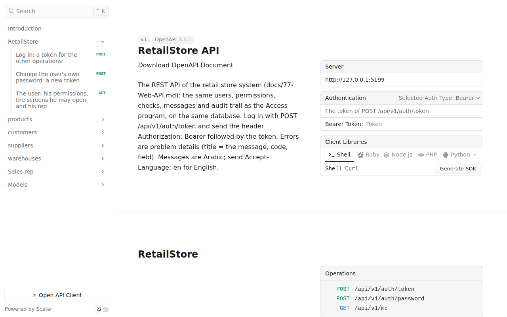

# واجهة الـ APIs وتوثيقها (المرحلة 6ب)

**الفكرة:** المرحلة الثانية من الخطة 6 (`docs/51`). الموقع (`docs/76`) صار يقدّم **واجهة برمجية REST** تستعملها التطبيقات والأنظمة الأخرى: تطبيق المندوب على الجوال (4د)، ونقطة البيع على Windows (6و)، وأي ربط مع نظام خارجي.

- **قبلها:** البيانات تُقرأ وتُكتب من شاشات Access أو من صفحات الموقع فقط.
- **الآن:** كل عملية لها عنوان ثابت تحت `/api/v1`، يُدخل إليه بـ **رمز دخول (JWT)**، ولها **صلاحية** مكتوبة، و**كل كتابة تُسجَّل في سجل التدقيق** نفسه. والتوثيق صفحة تفاعلية داخل الموقع.

**القاعدة:** الـ API لا يكتب قواعد جديدة. كل عملية تمر بالخدمات نفسها التي تستعملها صفحات الموقع، وهي نسخة C# من كود VBA: الفحوص نفسها بالترتيب نفسه، والرسائل العربية نفسها، وصفوف سجل التدقيق نفسها. فالعمل من التطبيق يظهر في Access فورًا، والعكس.

**لا تغيير في Access في هذه المرحلة:** لا وحدة تُستورد ولا أمر بناء.



## 1) الدخول برمز (JWT)
1. التطبيق يرسل اسم المستخدم وكلمة المرور واسم الجهاز إلى `POST /api/v1/auth/token`.
2. يرجع **رمز** صالح 12 ساعة (يُغيَّر من `appsettings.json`).
3. يرسل التطبيق الرمز مع كل طلب في الرأس: `Authorization: Bearer` ثم الرمز.

**قواعد الدخول هي قواعد Access** (`modSecurity.LoginUser`):
- نفس المستخدمين وكلمات المرور.
- 5 محاولات خاطئة تقفل الحساب 15 دقيقة، والرسالة واحدة لاسم غير موجود ولكلمة مرور خاطئة.
- المستخدم الذي يجب أن يغيّر كلمة مروره لا يعمل شيئًا إلا `POST /api/v1/auth/password` و`GET /api/v1/me`.
- كل دخول في **سجل التدقيق**: «الجهاز» = `API` ثم اسم الجهاز الذي يرسله التطبيق ثم عنوانه.

**حماية إضافية للرمز:**
- **تغيير كلمة المرور يُنهي كل الرموز السابقة** فورًا (الرمز يحمل بصمة كلمة المرور). وتغييرها من الـ API يرجع رمزًا جديدًا.
- **تعطيل المستخدم** في Access يُنهي رموزه فورًا.
- **محاولات الدخول محدودة:** 10 في الدقيقة لكل عنوان (`Api:LoginsPerMinute`)، وبعدها رد `429`.
- **مفتاح التوقيع** لا يُكتب في المستودع أبدًا: إن تُرك `Api:JwtKey` فارغًا، يُنشئ الموقع مفتاحًا عشوائيًا في `App_Data\api-jwt.key` عند أول تشغيل ويحتفظ به. **انسخ هذا الملف مع النسخة الاحتياطية للموقع:** ضياعه يُلغي الرموز الحالية فقط، فيدخل المستخدمون من جديد.
- الـ API لا يقبل كوكي الموقع، وصفحات الموقع لا تقبل رمز الـ API.

## 2) العمليات
**الصلاحية** في الجدول هي صلاحية Access نفسها. ومع «شاشة» فهي صلاحيات تلك الشاشة للمستخدم الذي له صلاحيات شاشات خاصة (`frmUserScreens`): فتح، وإضافة، وتعديل، وحذف.

### الدخول والمستخدم
| العملية | العنوان | الصلاحية |
|---|---|---|
| الدخول | `POST /api/v1/auth/token` | — |
| تغيير كلمة المرور | `POST /api/v1/auth/password` | المستخدم نفسه |
| من أنا: صلاحياتي، والشاشات المسموحة، والمندوب المرتبط بي | `GET /api/v1/me` | المستخدم نفسه |

### شاشات البيانات: المنتجات، والعملاء، والموردون، والمخازن
لكل شاشة من `products` و`customers` و`suppliers` و`warehouses` ست عمليات:

| العملية | العنوان | الصلاحية |
|---|---|---|
| القائمة: البحث، و«إظهار غير النشط»، وصفحات (`skip` و`take` حتى 1000) | `GET /api/v1/products?search=&includeInactive=&skip=&take=` | صلاحية الشاشة |
| سجل واحد | `GET /api/v1/products/{id}` | صلاحية الشاشة |
| خيارات الحقول: القوائم المنسدلة وقوائم القيم | `GET /api/v1/products/lookups` | صلاحية الشاشة |
| إضافة | `POST /api/v1/products` | الشاشة: إضافة |
| تعديل | `PUT /api/v1/products/{id}` | الشاشة: تعديل |
| حذف أو تعطيل | `DELETE /api/v1/products/{id}?deactivate=` | الشاشة: حذف |

صلاحيات الشاشات: المنتجات `PRODUCTS`، والعملاء `CUSTOMERS`، والموردون `SUPPLIERS`، والمخازن `PRODUCTS`.

**السجل في الـ API:** الحقول هي حقول الشاشة بأسمائها في القاعدة، مثل `ProductName` و`SellingPrice`. وتُقبل بأي حالة أحرف (`productName`).
- **الإضافة والتعديل يمران بفحوص الشاشة نفسها وبالترتيب نفسه** (`docs/76` القسم 1): الحقول المطلوبة، والقواعد، وقواعد الشاشة، والقيم التي لا تتكرر، ثم رقم التسلسل.
- **التعديل يغيّر الحقول المرسلة فقط.** والحقول الأخرى تبقى كما في القاعدة.
- **الحقول المقفلة تُتجاهل**، مثل الكمية والتكلفة والرصيد: البرنامج وحده يحسبها. فالسجل الذي يُقرأ من الـ API يمكن إرساله كما هو.
- **السؤال:** مثل «سعر البيع أقل من التكلفة. هل تريد الحفظ على أي حال؟». يرجع الرد `409` والرمز `confirm`. يسأل التطبيق المستخدم، ثم يرسل الطلب نفسه مع `?confirm=true`.
- **الحذف:** السجل المستعمل في عمليات يرجع `409` (`confirm`)، فيرسل التطبيق `?deactivate=true` لتعطيله بدلًا من حذفه، كما في Access.

### عمل المندوب (لتطبيق المندوب، 4د)
كل عمليات `/api/v1/rep` تعمل **للمندوب المرتبط بالمستخدم فقط** (`SalesReps.EmployeeID`). المستخدم غير المرتبط بمندوب نشط يرجع له `403` بالرمز `not_a_rep`. ولا يرى المندوب بيانات مندوب آخر ولا يعدّلها.

| العملية | العنوان | الصلاحية | مثل Access |
|---|---|---|---|
| ملف المندوب: مخزن السيارة، وصندوق العهدة، ومخزن الطلبيات، وحد الائتمان، وأرصدة عملائه | `GET /api/v1/rep/profile` | المندوب نفسه | `docs/63`، `docs/64` |
| عملاء المندوب: المسندون إليه، ومن في خط سيره (بأيام الزيارة) | `GET /api/v1/rep/customers` | `REP_ROUTES` | |
| الأصناف بسعر سطر الطلبية للعميل، ورصيد سيارة المندوب | `GET /api/v1/rep/products?customerId=` | `SALES_ORDERS` | `OrderDefaultPrice` |
| رصيد سيارة المندوب | `GET /api/v1/rep/van-stock` | `REP_ROUTES` | `AvailableQty` |
| زيارات يوم (اليوم إن لم يُذكر) | `GET /api/v1/rep/visits?date=` | `REP_ROUTES` | |
| خطة اليوم من خط السير | `POST /api/v1/rep/visits/plan` | `REP_ROUTES` | `CreateVisitPlan` |
| زيارة خارج خط السير | `POST /api/v1/rep/visits` | `REP_ROUTES` | `AddRepVisit` |
| تسجيل نتيجة زيارة | `PUT /api/v1/rep/visits/{id}` | `REP_ROUTES` | `RecordRepVisit` |
| حذف زيارة لم تُسجَّل | `DELETE /api/v1/rep/visits/{id}` | `REP_ROUTES` | `DeleteRepVisit` |
| طلبيات المندوب، والتي سجّلها المستخدم، بين يومين، بأسطرها وحالتها | `GET /api/v1/rep/orders?from=&to=` | `SALES_ORDERS` | |
| طلبية واحدة | `GET /api/v1/rep/orders/{id}` | `SALES_ORDERS` | |
| **طلبية عميل جديدة (مسودة) بأسطرها** | `POST /api/v1/rep/orders` | `SALES_ORDERS` | `CreateSalesOrder` |

**سعر الصنف للعميل** هو سعر سطر الطلبية في Access (`OrderDefaultPrice`):
1. سعر الصنف في **قائمة أسعار العميل**. وبين البنود السارية في اليوم، يغلب البند الذي يبدأ آخرًا.
2. وإلا **سعر المندوب** (`RepPrices`) أو سعر البيع، مخصومًا منه **خصم قائمة العميل**.

**الطلبية من التطبيق:**
- تُحفظ **مسودة** برقم `SO-`، في مخزن المستخدم (أو المخزن المرسل)، ومندوبها مندوب العميل (`SalesRepFor`). فعميل مندوب آخر في خط سيره يأخذ أسعار مندوبه، في قائمة الأصناف وفي الطلبية.
- كل سطر يُفحص كما في Access: الصنف يتابع المخزون، والكمية أكبر من صفر، والسعر غير سالب.
- السطر بلا سعر يأخذ سعر العميل.
- **المكتب يعتمدها في Access**، والاعتماد يحجز الكمية (`docs/62`).
- الطلبية وأسطرها في سجل التدقيق.

**نتيجة الزيارة** إن لم تُرسل تُقرأ من مستندات العميل في ذلك اليوم: بيع، وإلا طلبية، وإلا تحصيل. فالطلبية من التطبيق تجعل نتيجة الزيارة «طلبية» تلقائيًا.

## 3) الردود والأخطاء
- **النجاح:** `200`، أو `201` للإضافة مع عنوان السجل الجديد.
- **الخطأ:** بصيغة «Problem Details» المعيارية (RFC 9457)، وفيه:
  - `title`: رسالة البرنامج نفسها؛
  - `code`: نوع الخطأ؛
  - `field`: الحقل الذي يُصحَّح، إن وُجد.

| الحالة | `code` | المعنى |
|---|---|---|
| 401 | `unauthorized` / `login_failed` | بلا رمز، أو رمز منتهٍ أو ملغى، أو دخول خاطئ |
| 403 | `forbidden` / `password_change_required` / `not_a_rep` | لا صلاحية، أو يجب تغيير كلمة المرور، أو المستخدم ليس مندوبًا |
| 404 | `not_found` | السجل غير موجود |
| 409 | `confirm` | سؤال: أعد الطلب مع `?confirm=true`، أو `?deactivate=true` في الحذف |
| 422 | `refused` | رفضه البرنامج، والسبب في `title` |
| 429 | — | محاولات دخول كثيرة. انتظر دقيقة |

**اللغة:** الرسائل وأسماء العملاء والأصناف والمخازن **بالعربية**. ومع الرأس `Accept-Language: en` (أو `?lang=en`) تأتي **بالإنجليزية**، بقاموس الواجهة الإنجليزية نفسه (`docs/38`).

**مثال:**
```
POST /api/v1/auth/token
{ "username": "rep1", "password": "...", "device": "Samsung A54" }
→ { "accessToken": "eyJ...", "tokenType": "Bearer", "expiresAt": "...", "mustChangePassword": false, ... }

POST /api/v1/rep/orders        (Authorization: Bearer eyJ...)
{ "customerID": 12, "notes": "تسليم صباحًا",
  "lines": [ { "productID": 5, "quantity": 3 }, { "productID": 9, "quantity": 2, "unitPrice": 9.5 } ] }
→ 201 { "id": 41, "message": "" }
```

## 4) التوثيق
- **صفحة تفاعلية:** `/api/docs`. فيها كل عملية بشرحها وصلاحيتها وأمثلة الطلب والرد، وتُجرَّب العمليات منها بعد لصق الرمز. ملفاتها داخل الموقع، فتعمل بلا إنترنت، ولا ترسل شيئًا خارج المحل.
- **وثيقة OpenAPI 3.1:** `/api/openapi/v1.json`. منها تُولَّد مكتبة الاتصال لتطبيق MAUI أو لأي نظام آخر.
  - **صلاحية كل عملية** مكتوبة في وصفها، وفي الحقل `x-permission`.
- لإخفاء التوثيق على خادم الإنتاج: `"Api": { "Docs": false }` في `appsettings.json`.

## 5) الإعدادات (`appsettings.json`)
```json
"Api": {
  "JwtKey": "",
  "TokenHours": 12,
  "LoginsPerMinute": 10,
  "Docs": true
}
```
- `JwtKey`: فارغ = مفتاح عشوائي في `App_Data\api-jwt.key` (الأفضل). أو نص لا يقل عن 32 حرفًا، **لا يُرفع إلى المستودع**. ويفيد عند تشغيل أكثر من خادم للموقع نفسه.
- `TokenHours`: مدة الرمز بالساعات.
- `LoginsPerMinute`: حد محاولات الدخول لكل عنوان في الدقيقة.
- `Docs`: إظهار صفحة التوثيق ووثيقة OpenAPI.

**الاستضافة:** HTTPS إلزامي على الخادم الحقيقي، لأن الرمز وكلمة المرور يمران في الطلب. يُضبط عند قرار الاستضافة (مؤجل إلى التسليم).

## 6) كيف بُني
| الملف | ما فيه |
|---|---|
| `web/src/RetailStore.Web/Api/ApiEndpoints.cs` | الدخول، و«من أنا»، وعمليات شاشات البيانات |
| `web/src/RetailStore.Web/Api/RepApi.cs` | عمليات المندوب |
| `web/src/RetailStore.Web/Api/ApiSecurity.cs` | الرموز، وفحص المستخدم والصلاحيات في كل طلب، والمندوب |
| `web/src/RetailStore.Web/Api/ApiSetup.cs` | الإعداد: JWT، وحد المحاولات، وOpenAPI وصفحة التوثيق |
| `web/src/RetailStore.Web/Api/ApiResults.cs` | الردود والأخطاء والترجمة |
| `web/src/RetailStore.Data/Services/RepService.cs` | عمل المندوب بـ C#: نسخة `modRepRoutes` و`modSalesOrders` و`modPriceLists` و`modWarehouses` |
| `web/src/RetailStore.Data/DataScreens/RecordJson.cs` | السجل في JSON، وكتابة الحقول المرسلة عليه |

- **أخطاء الـ API ترجع JSON دائمًا،** لا صفحة الموقع ولا صفحة الدخول.
- **مكتبات جديدة** (من Microsoft، وصفحة Scalar للتوثيق): `Microsoft.AspNetCore.Authentication.JwtBearer` و`Microsoft.AspNetCore.OpenApi` و`Scalar.AspNetCore`. وللاختبار `Microsoft.AspNetCore.Mvc.Testing`.

## 7) طريقة الاختبار
**الاختبارات الآلية:**
```
python3 tools/generate.py
python3 -m unittest discover -s tests -p "test_web.py"
```
- **بـ Python:**
  - رسائل خدمة المندوب هي رسائل VBA حرفيًا.
  - لكل عملية صلاحية وشرح.
  - مفتاح التوقيع ليس في المستودع.
  - أخطاء الـ API لا تكون صفحة.
- **بـ xUnit** (32 اختبارًا، منها 7 للـ API، على الموقع الحقيقي بقاعدة SQLite في الذاكرة):
  - الدخول، وتغيير كلمة المرور يُنهي الرمز القديم، وتعطيل المستخدم، والرمز المزوّر، وحد المحاولات.
  - الحفظ والسؤال والرفض والحذف والتعطيل، وسجل التدقيق، والصفحات، والرسالة بالإنجليزية.
  - المندوب: صلاحياته، وعملاؤه، والأسعار (قائمة العميل، وسعر المندوب مع خصم القائمة)، ورصيد السيارة، والخطة، والزيارات، والطلبية، ونتيجة الزيارة، ومنع بيانات مندوب آخر.
  - وثيقة OpenAPI: كل العمليات (39) بشرحها وصلاحيتها.

**يدويًا (بقاعدة التجربة):**
1. `cd web\src\RetailStore.Web` ثم `dotnet run`، وافتح `http://localhost:5137/api/docs`.
2. في «Log in» أرسل `{"username":"admin","password":"..."}`. انسخ `accessToken` والصقه في «Authentication».
3. جرّب `GET /api/v1/products`، ثم أضف منتجًا بسعر بيع أقل من التكلفة: يرجع `409`. أعده مع `confirm=true`.
4. في Access (على SQL Server): اربط مستخدمًا بمندوب في شاشة المندوبين، وأعطه شاشتي «زيارات المندوبين» و«طلبيات العملاء» فقط. ثم ادخل به في الـ API:
   - `GET /api/v1/customers` يرجع `403`؛
   - `POST /api/v1/rep/visits/plan` ينشئ خطة اليوم من خط سيره؛
   - `POST /api/v1/rep/orders` ينشئ طلبية تظهر في Access مسودةً.
5. افتح «سجل التدقيق» في Access: العمليات بجهاز `API ...`.
6. غيّر كلمة مرور هذا المستخدم في Access، ثم أعد أي طلب بالرمز القديم: يرجع `401`.

## 8) ما لم يُبنَ بعد
- **تطبيق المندوب نفسه** (4د، MAUI Blazor Hybrid على Android): يعمل بلا إنترنت بقاعدة على الجهاز، ثم يزامن بهذه العمليات. وتضاف معه:
  - **رقم الطلب من الجهاز** (منع تكرار الطلبية إذا أُعيد إرسالها بعد انقطاع الشبكة)؛
  - **«ما تغيّر منذ آخر مزامنة»** في القوائم.
- **الفاتورة والتحصيل من التطبيق:** تحتاج نقل `PostSaleFromCart` وسندات القبض إلى C#، مع المبيعات على الويب (6ج).
- **مستندات أخرى في الـ API** (الفواتير، والمشتريات، والمخزون، والمحاسبة) تأتي مع شاشاتها (6ج-6هـ).
