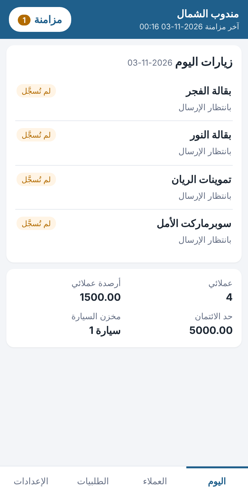
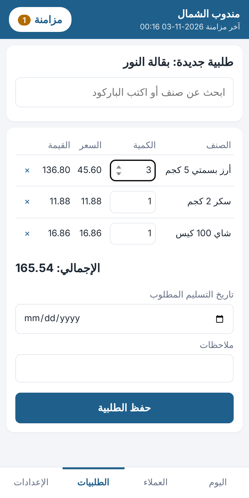
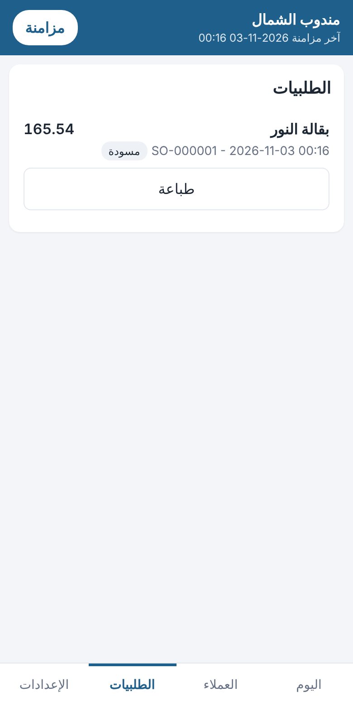

# تطبيق المندوب على Android (المرحلة 4د)

**الفكرة:** آخر مراحل خطة المندوبين (`docs/51`، الخطة 4)، وأول تطبيق من الخطة 6. المندوب يعمل من جواله في الشارع:
- يرى عملاءه وأرصدتهم وخط سير اليوم؛
- يسجّل الزيارة ونتيجتها؛
- يأخذ **طلبية العميل** بسعر العميل نفسه في Access؛
- يطبع نسخة للعميل على **طابعة بلوتوث**.

**كل ذلك بلا إنترنت.** ما يسجّله يُحفظ على الجوال، ويُرسل إلى البرنامج عند عودة الاتصال بعمليات `/api/v1/rep` (`docs/77`). الطلبية تصل إلى Access **مسودة**، ويعتمدها المكتب كالمعتاد فتُحجز كميتها (`docs/62`).

**التقنية:** .NET MAUI Blazor Hybrid، كما قرر صاحب المشروع (الخطة 6). الشاشات مكتوبة بـ Razor في مكتبة مشتركة، وتعمل غدًا في نقطة البيع على Windows (6و) وعلى iOS عند الطلب.

**في Access:** حقل جديد واحد، `SalesOrders.ClientRef`. استبدل `modBuildSchema` وشغّل `BuildSchema` (القسم 6).

| زيارات اليوم | طلبية جديدة بسعر العميل | الطلبيات وحالتها |
|---|---|---|
|  |  |  |

## 1) الشاشات
| الشاشة | ما فيها |
|---|---|
| **الدخول** | عنوان الخادم، واسم المستخدم وكلمة المرور نفسهما في Access. وإن كان يجب تغيير كلمة المرور فتُغيَّر أولًا |
| **اليوم** | زيارات اليوم ونتيجة كل زيارة. زر «خطة اليوم من خط السير» يعمل بلا إنترنت: عملاء خط السير ليوم الأسبوع. وتحتها أرقام المندوب: عدد عملائه، وأرصدتهم، وحد الائتمان، ومخزن السيارة |
| **العملاء** | بحث بالاسم أو الجوال، و«خط سير اليوم» فقط. ولكل عميل: الرصيد، وحد الائتمان، والجوال (اتصال بلمسة)، والعنوان |
| **العميل** | «طلبية جديدة»، وزيارة اليوم: تسجيل النتيجة («من مستندات اليوم»، أو لا شيء، أو المحل مغلق، أو تحصيل) مع ملاحظة، أو «زيارة خارج خط السير» |
| **طلبية جديدة** | بحث عن صنف بالاسم أو الرمز أو الباركود. يظهر سعره للعميل ورصيده في السيارة. ثم الكمية، والإجمالي، وتاريخ التسليم المطلوب، والملاحظات. بعد الحفظ: «طباعة نسخة العميل» |
| **الطلبيات** | طلبيات الجهاز (بانتظار الإرسال، أو رفضها البرنامج مع السبب) وطلبيات المندوب في البرنامج آخر 14 يومًا بحالتها: مسودة، ثم معتمدة، ثم قيد التجهيز... ولكل طلبية زر «طباعة» |
| **الإعدادات** | المستخدم والخادم والجهاز، والطابعة وعرض الورق (58 أو 80 مم)، وتغيير كلمة المرور، والخروج، والعربية / English |

**زر «مزامنة»** في أعلى كل شاشة:
- عليه عدد العمليات التي لم تُرسل بعد؛
- تحته وقت آخر مزامنة، أو سبب توقفها.

والمزامنة تتم أيضًا تلقائيًا عند فتح التطبيق، وبعد حفظ كل طلبية أو زيارة.

## 2) العمل بلا إنترنت
عند كل مزامنة يحفظ الجوال **صورة من بيانات المندوب** في ملف SQLite داخله، بقراءة واحدة: `GET /api/v1/rep/sync`. وفيها:
- ملف المندوب (`docs/77`)، واسم المحل؛
- عملاؤه: المسندون إليه، ومن في خط سيره؛
- الأصناف النشطة ورصيد سيارته؛
- **أسعار كل عميل** (أدناه)؛
- زيارات اليوم؛
- طلبياته آخر 14 يومًا بأسطرها وحالتها.

**سعر الصنف للعميل بلا إنترنت هو سعر Access نفسه** (`OrderDefaultPrice`، `docs/77`):
- العملاء الذين لهم نفس «مندوب الطلبية» ونفس قائمة الأسعار **مجموعة أسعار واحدة**.
- يحسب البرنامج أسعار كل مجموعة مرة واحدة، ويرسل **ما يختلف فقط** عن السعر العادي. فالصورة صغيرة ولو كثر العملاء.
- اختبار يقارن، لكل عميل ولكل صنف، سعر الجوال بسعر `/api/v1/rep/products?customerId=` من البرنامج.

**ما يُسجَّل بلا إنترنت** يُحفظ في «صندوق الإرسال» على الجوال، ولا يضيع إن أُغلق التطبيق:

| العملية | تُرسل إلى | مثل Access |
|---|---|---|
| طلبية عميل | `POST /api/v1/rep/orders` برقمها في الجهاز | `CreateSalesOrder` |
| خطة اليوم | `POST /api/v1/rep/visits/plan` | `CreateVisitPlan` |
| زيارة خارج خط السير | `POST /api/v1/rep/visits` | `AddRepVisit` |
| نتيجة زيارة | `PUT /api/v1/rep/visits/{id}` | `RecordRepVisit` |

**فحوص سطر الطلبية تتم على الجوال فورًا، برسائل Access نفسها:** الصنف الذي لا يتابع المخزون، والكمية صفر. فيعرف المندوب الخطأ وهو عند العميل، لا عند المزامنة.

## 3) المزامنة
**الترتيب:**
1. **الطلبيات أولًا.**
2. ثم الزيارات بترتيب تسجيلها: الخطة والزيارة الجديدة قبل نتيجتها.
3. ثم تُقرأ صورة البيانات من جديد.

لماذا الطلبيات أولًا: نتيجة الزيارة «من مستندات اليوم» يقرؤها البرنامج من مستندات العميل في ذلك اليوم. فإذا وصلت طلبيته قبلها، صارت النتيجة «طلبية» تلقائيًا.

**الطلبية لا تتكرر أبدًا:**
- لكل طلبية **رقم في الجهاز** (`ClientRef`)، يُحفظ معها في `SalesOrders.ClientRef` (فهرس لا يتكرر).
- إذا انقطع الاتصال بعد وصول الطلبية وقبل وصول الرد، يرسلها الجوال مرة ثانية. فيجد البرنامج الرقم نفسه للمستخدم نفسه، فيرد برقم الطلبية الموجودة (`200`) ولا يضيفها ثانية.
- **تاريخ الطلبية** هو وقت أخذها على الجوال، لا وقت وصولها (ولا يكون بعد وقت الوصول).
- الرقم لمستخدم آخر يُرفض، والرقم الأطول من 40 حرفًا يُرفض.

**ما يوقف المزامنة وما يوقف عملية واحدة:**

| الحالة | ما يحدث |
|---|---|
| لا إنترنت، أو تعذر الوصول إلى الخادم، أو خطأ في الخادم | تتوقف المزامنة، وتبقى العمليات «بانتظار الإرسال» للمرة التالية |
| انتهى الدخول: كلمة مرور جديدة، أو تعطيل المستخدم، أو انتهاء مدة الرمز | تتوقف، ويُطلب الدخول من جديد. **لا يضيع شيء** |
| رفضه البرنامج (مثل: العميل أُوقف في المكتب، «اختر العميل.») | تتوقف هذه العملية وحدها: «رفضها البرنامج» مع السبب، وتكمل الباقي. يصحح المكتب السبب ثم «إعادة الإرسال»، أو «حذف من الجهاز» |

**الجهاز لمستخدم واحد في كل مرة:**
- الخروج يُبقي البيانات والعمليات غير المرسلة حتى يدخل المستخدم نفسه.
- لا يدخل مستخدم آخر وعلى الجهاز عمليات لم تُرسل للأول: «ادخل باسمه وزامن أولًا». وبعد ذلك تُمسح بيانات الأول من الجهاز.

## 4) الطباعة على طابعة بلوتوث
- **الربط:** أولًا من إعدادات البلوتوث في الجوال، ثم اختيار الطابعة وعرض الورق في «الإعدادات».
- **نسخة العميل:**
  - اسم المحل، و«طلبية عميل»، ورقمها: رقم `SO-` بعد المزامنة، وقبلها أول 8 أحرف من رقمها في الجهاز؛
  - التاريخ، والعميل، والمندوب؛
  - كل صنف بكميته وسعره وقيمته، والإجمالي، والملاحظات؛
  - «لم تُرسل إلى المكتب بعد» إن لم تُرسل؛
  - و**«طلبية وليست فاتورة ضريبية»**.
- **العربية:** طابعات الإيصالات الصغيرة لا تصل الحروف العربية ولا تكتب من اليمين. لذلك **يرسم الجوال النسخة صورة** (Android يصل الحروف ويكتب من اليمين)، ويرسلها إلى الطابعة بأوامر ESC/POS (`GS v 0`) على دفعات، ثم يقطع الورق.
- تعمل على أي طابعة ESC/POS ببلوتوث (SPP)، مثل طابعات 58 و80 مم الشائعة.

## 5) الإعداد والتثبيت
**الخادم:**
- يجب أن يكون الموقع (`docs/76`) يعمل، وأن يصل إليه الجوال:
  - **داخل المحل:** عنوانه في الشبكة، مثل `http://192.168.1.10:5000`. التطبيق يقبل `http`، فاستعمله داخل شبكة المحل فقط.
  - **من خارج المحل:** عنوان على الإنترنت، **بـ HTTPS إلزامًا** (`docs/77`).
- قرار الاستضافة مؤجل إلى التسليم، كما طلبت.

**المستخدم في Access:**
1. مستخدم للمندوب، مربوط بالمندوب في شاشة المندوبين (`SalesReps.EmployeeID`).
2. صلاحيتا «طلبيات العملاء» (`SALES_ORDERS`) و«خط السير وزيارات المندوبين» (`REP_ROUTES`)، أو شاشتاهما في صلاحيات الشاشات الخاصة. بلا `REP_ROUTES` يعمل التطبيق للطلبيات وحدها.
3. مخزن سيارة له (`docs/63`) ليظهر رصيد السيارة.

**بناء التطبيق** (على جهازك؛ يحتاج .NET 10 SDK، وأداة MAUI لـ Android، وJava 17 أو أحدث):
```
dotnet workload install maui-android
cd web
dotnet build src\RetailStore.App -t:InstallAndroidDependencies -f net10.0-android -p:AcceptAndroidSDKLicenses=True
dotnet publish src\RetailStore.App -f net10.0-android -c Release
```
- الملف الناتج: `web\src\RetailStore.App\bin\Release\net10.0-android\publish\com.retailstore.rep-Signed.apk`. ينقل إلى الجوال ويُثبَّت (مع السماح بالتثبيت من مصادر غير معروفة).
- أو افتح `web\RetailStore.Mobile.slnx` في Visual Studio 2026 واختر جهاز Android.
- للنشر في Google Play: ملف `aab` بتوقيع المحل، عند الطلب.

## 6) ما الذي تغيّر في Access
| التغيير | التفاصيل |
|---|---|
| حقل جديد | `SalesOrders.ClientRef` (نص 40، اختياري): «رقم الطلبية في جهاز المندوب». فهرس لا يتكرر، ويتجاهل الفارغ |
| الوحدات | `modBuildSchema` فقط (يضيف الحقل والفهرس إلى قاعدة موجودة) |
| SQL Server | `dist/sql/RetailStore_Schema.sql` مولَّد من جديد. تشغيله على قاعدة موجودة يضيف الحقل والفهرس |
| الشاشات | لا تغيير. الطلبية من التطبيق تظهر في شاشة الطلبيات كأي مسودة، ورقمها في الجهاز في سجل التدقيق (`SALES_ORDER_NEW` بالتفاصيل `api` ثم الرقم) |

## 7) طريقة الاختبار
**آليًا** (هنا وعلى جهازك):
- `python3 -m unittest discover -s tests -p "test_web.py"`؛
- أو `dotnet test` في `web`.

اختبارات التطبيق في `RepAppTests.cs`، **على الـ API الحقيقي** وقاعدة تجربة:
1. **طلبية وزيارة بلا إنترنت:**
   - رفض صنف الخدمة والكمية صفر، وسعر قائمة العميل.
   - إغلاق التطبيق وفتحه دون فقد شيء.
   - عند عودة الاتصال: الطلبية مسودة بتاريخ أخذها وسعرها، والزيارة «طلبية» من مستندات اليوم.
   - **إعادة إرسال الطلبية نفسها لا تضيفها ثانية.**
   - الطباعة.
2. **الأسعار:** سعر الجوال = سعر البرنامج لكل عميل وكل صنف، ومنهم عميل مندوب آخر في خط السير.
3. **الرفض:**
   - عميل أُوقف: تُرفض طلبيته وحدها، ثم تُرسل بعد تنشيطه.
   - كلمة مرور جديدة: يُطلب الدخول ولا يضيع شيء.
   - مستخدم آخر لا يدخل قبل مزامنة الأول.
4. **رقم الجهاز** لمستخدمه وحده، وطوله.
5. **أوامر الطابعة:** الصورة على دفعات، والبايتات بالضبط، ونص نسخة العميل بالعربية والإنجليزية.

**ما تم هنا:**
- **ترجمة كود Android بنجاح** (`RetailStore.App`)، والتحذيرات تُعامل كأخطاء.
- **تشغيل الشاشات في المتصفح** على الـ API الحقيقي: الدخول، وخطة اليوم، والطلبية، والطلبيات (الصور أعلاه).

**ما لا يتم هنا:** بناء ملف APK. يحتاج Android SDK من Google، وهو غير متاح في بيئة التطوير.

**يدويًا على جوال Android:**
1. ابنِ التطبيق وثبّته (القسم 5)، وشغّل الموقع على جهاز في الشبكة نفسها.
2. أعدّ مندوبًا في Access (القسم 5)، ثم ادخل من التطبيق بعنوان الموقع.
3. «خطة اليوم من خط السير»، ثم عميل، ثم «طلبية جديدة» بصنفين، ثم «حفظ الطلبية». تأكد من ظهورها مسودة في شاشة الطلبيات في Access.
4. **أوقف الإنترنت في الجوال.** خذ طلبية، وسجّل زيارة. يظهر العدد على زر «مزامنة». أغلق التطبيق وافتحه: ما زالت موجودة.
5. **أعد الإنترنت:** تُرسل وحدها، ويختفي العدد. الطلبية في Access بوقت أخذها.
6. **الطابعة:** اربطها بالبلوتوث، واخترها في «الإعدادات»، ثم «طباعة» طلبية. تأكد أن العربية متصلة الحروف ومن اليمين.
7. **الرفض:** أوقف عميلًا في Access ثم أرسل له طلبية من الجوال: تظهر «رفضها البرنامج» بالسبب. نشّطه ثم «إعادة الإرسال».

## 8) كيف بُني
| الملف | ما فيه |
|---|---|
| `web/src/RetailStore.RepApp/` | مكتبة التطبيق (Razor Class Library)، **لا تصل إلى قاعدة البيانات**: `Client/RepApiClient.cs` (الاتصال بالـ API، والرمز، واللغة)، و`Offline/LocalStore.cs` (ملف SQLite على الجوال وصندوق الإرسال)، و`Offline/SyncService.cs` (المزامنة)، و`Offline/OrderDraft.cs` (السعر وفحوص السطر)، و`Offline/VisitBoard.cs` (زيارات اليوم مع ما لم يُرسل)، و`Offline/RepSession.cs` (حالة التطبيق)، و`Printing/` (نسخة العميل وأوامر ESC/POS)، و`Pages/` (الشاشات) |
| `web/src/RetailStore.App/` | تطبيق Android (MAUI Blazor Hybrid): `MauiProgram.cs`، و`Platforms/Android/PhonePlatform.cs` (حفظ الرمز في مخزن Android الآمن، وحالة الشبكة، والبلوتوث، ورسم النسخة) |
| `web/RetailStore.Mobile.slnx` | الحل كاملًا مع تطبيق Android. أما `RetailStore.slnx` فبدونه، فيُبنى الموقع على جهاز بلا أداة MAUI |
| `RepService.SnapshotAsync`، `RepApi.cs` (`/rep/sync`) | صورة البيانات ومجموعات الأسعار في البرنامج |
| `RepService.CreateOrderAsync` | رقم الطلبية في الجهاز (`ClientRef`) ووقت أخذها |
| `web/tests/RetailStore.Tests/RepAppTests.cs` | الاختبارات (القسم 7) |

**ما لم يُبنَ في هذه المرحلة** (يحتاج نقل `PostSaleFromCart` وسند القبض إلى C#، مع 6ج):
- **فاتورة البيع من السيارة** و**التحصيل** من التطبيق. يبقيان اليوم في Access أثناء «العمل باسم المندوب» (`docs/63`).
